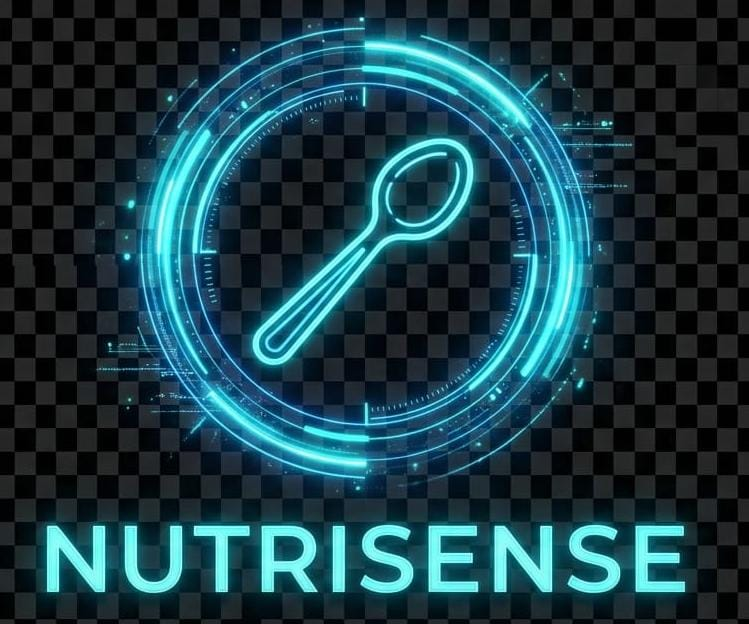
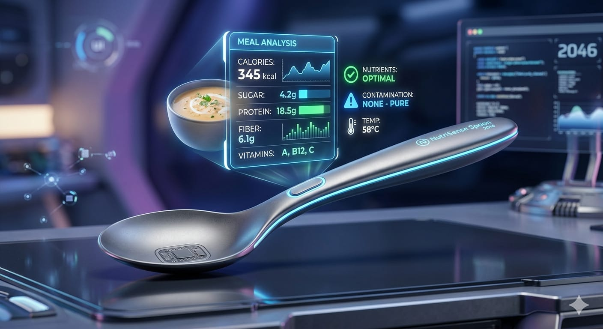

 <div align="center">



# 🥄 NutriSense Spoon

### **AI-Powered Food Intelligence**

**From what you eat → to what it means for you.**

<p>
  <a href="https://nutrisense-spoon.lovable.app/">
    
  </a>
  <a href="https://github.com/Abiya-Daniel/nutrisense-spoon-web">
    
  </a>
</p>

<br>



<br><br>


</div>

---

## 🌱 The Idea

> ### **People eat meals. Technology should understand meals.**

Most nutrition apps depend on manual logging and standardized food databases. However, homemade meals, regional cuisines, recipes, and portion sizes make nutrition tracking challenging.

**NutriSense Spoon** aims to simplify this through intelligent food understanding.

```text
FOOD
  ↓
FOOD UNDERSTANDING
  ↓
NUTRITION CONTEXT
  ↓
PERSONALIZATION
  ↓
ACTIONABLE INSIGHT
```

---

## 🎯 The Problem

### Nutrition apps are built for database entries. People eat real meals.

| Challenge | Why it matters |
|---|---|
| 🍛 Homemade food | Difficult to find standardized entries |
| 🥘 Mixed dishes | Multiple ingredients in one meal |
| 🌾 Regional cuisine | Local foods may be underrepresented |
| 👩‍🍳 Recipe variation | Preparation changes nutritional values |
| 🥄 Portion uncertainty | Exact quantities are difficult to estimate |

> **People eat real meals. Nutrition systems need to understand them.**

---

## 💡 The Product

NutriSense Spoon is envisioned as a food intelligence system that connects meal understanding with nutrition and personal context.

```text
┌──────────────────┐
│    MEAL INPUT    │
└────────┬─────────┘
         ↓
┌──────────────────┐
│ FOOD UNDERSTANDING│
└────────┬─────────┘
         ↓
┌──────────────────┐
│ NUTRITION ENGINE │
└────────┬─────────┘
         ↓
┌──────────────────┐
│ PERSONALIZATION  │
└────────┬─────────┘
         ↓
┌──────────────────┐
│ ACTIONABLE INSIGHT│
└──────────────────┘
```

---

## 🧠 Five Intelligence Layers

| Layer | Purpose |
|---|---|
| 🍽️ **Food Intelligence** | Understand dishes, ingredients, and regional foods |
| 🥄 **Portion Intelligence** | Estimate serving quantities |
| 📊 **Nutrition Intelligence** | Generate nutritional estimates |
| 👤 **Personal Intelligence** | Consider individual goals and preferences |
| 💡 **Action Intelligence** | Turn information into useful insights |

---

## 🇮🇳 Why India First?

India's diverse food culture makes it an important starting point for food intelligence.

**Region · Culture · Ingredients · Recipes · Preparation · Portions**

### Initial Focus

**AI-powered understanding of Indian meals.**

### Long-Term Opportunity

**Indian Food Intelligence → Global Food Intelligence**

---

## ⭐ What Makes It Different?

| Traditional Approach | NutriSense Spoon |
|---|---|
| Manual food logging | Intelligent food understanding |
| Individual food entries | Whole-meal context |
| Standardized records | Real-world food complexity |
| Nutrition numbers | Personalized insights |
| Tracking-first | Understanding-first |

> **Not another food diary. A system that aims to understand food.**

---

## 📱 Product Experience

The intended user journey:

<div align="center">

**📸 CAPTURE** — Provide the meal

↓

**🧠 UNDERSTAND** — Interpret the food

↓

**📊 ANALYZE** — Estimate portions and nutrition

↓

**👤 PERSONALIZE** — Apply individual context

↓

**💡 ACT** — Generate useful insights

</div>

---

## 👥 Who Is It For?

- **👤 Consumers** — Everyday nutrition understanding.
- **🧑‍⚕️ Nutrition Professionals** — Future tools for dietitians and nutritionists.
- **🏋️ Fitness & Wellness Platforms** — Food intelligence integrations.
- **🍽️ Food Businesses** — Nutrition experiences for restaurants.
- **🏫 Institutions** — Applications for cafeterias, colleges, and hostels.

---

## 📈 Go-To-Market Direction

<div align="center">

**🇮🇳 India**

↓

**Indian Food Intelligence**

↓

**Consumer Product**

↓

**Personalization**

↓

**Professional & B2B Solutions**

↓

**Food Intelligence API**

↓

**🌍 Global Expansion**

</div>

---

## 💰 Business Model

| Model | Opportunity |
|---|---|
| **B2C Freemium** | Premium insights and personalization |
| **Professional SaaS** | Tools for nutrition professionals |
| **B2B** | Business and platform integrations |
| **API** | Food intelligence for developers |

---

## 🏰 The Moat

The long-term advantage is intended to come from food intelligence infrastructure.

- **🧠 Regional Food Knowledge** — Local foods, ingredients, and recipes.
- **🔗 Food Knowledge Graph** — Connecting food, ingredients, preparation, and nutrition.
- **🔄 Feedback Loops** — Improving understanding through user feedback.
- **👤 Personalization** — Learning individual food patterns.
- **🌐 Ecosystem** — Integrations with professionals and platforms.

---

## 🗺️ Roadmap

```text
01  FOUNDATION
    Current Prototype
         ↓
02  FOOD INTELLIGENCE
    Recognition + Nutrition
         ↓
03  PERSONAL INTELLIGENCE
    Profiles + Insights
         ↓
04  ECOSYSTEM
    Professional + B2B
         ↓
05  PLATFORM
    API + Global Expansion
```

| Phase | Direction |
|---|---|
| **01 — Foundation** | Responsive web application and core product experience |
| **02 — Food Intelligence** | Food recognition, ingredient understanding, portion and nutrition estimation |
| **03 — Personal Intelligence** | User profiles, meal history, and personalized insights |
| **04 — Ecosystem** | Professional tools and business integrations |
| **05 — Platform** | Food Intelligence API and global expansion |

---

## 🧪 Current Status

<div align="center">

## 🟡 EARLY PROTOTYPE

</div>

The current repository contains the frontend foundation and initial product experience.

**Currently implemented**
- Responsive web application
- Nutrition-focused interface
- Interactive frontend
- Desktop and mobile layouts

**Planned**
- AI meal understanding
- Food and portion recognition
- Indian food intelligence
- Nutrition estimation
- Personalization and recommendations

> Roadmap features are future directions, not completed functionality.

---

## 🖥️ Product Preview

<div align="center">


</div>

---

## 🌐 Try the Prototype

<div align="center">

<a href="https://nutrisense-spoon.lovable.app/">

</a>

</div>

---

## 🛠️ Technology

### Current Stack

| Technology | Purpose |
|---|---|
| **React** | Frontend framework |
| **TypeScript** | Type-safe development |
| **Vite** | Development and build tooling |
| **Tailwind CSS** | Responsive styling |
| **Node.js & npm** | Runtime and package management |
| **Git & GitHub** | Version control |

**Future exploration:** Computer Vision · Multimodal AI · Machine Learning · Nutrition Databases · Knowledge Graphs · Recommendation Systems.

---

## 🏗️ Technical Architecture Direction

```text
       MEAL INPUT
           ↓
   FOOD UNDERSTANDING
           ↓
    FOOD + INGREDIENTS
           ↓
  PORTION INTELLIGENCE
           ↓
    NUTRITION ENGINE
           ↓
    PERSONALIZATION
           ↓
   ACTIONABLE INSIGHT
```

---

## 📂 Repository

```text
nutrisense-spoon-web/
│
├── public/
├── src/
├── web/
│   ├── logo.png
│   └── spoon.png
│
├── index.html
├── package.json
├── package-lock.json
├── vite.config.ts
├── tailwind.config.ts
├── tsconfig.json
├── postcss.config.js
├── eslint.config.js
├── .gitignore
└── README.md
```

---

## 🚀 Getting Started

### Prerequisites

- Node.js
- npm
- Git

### Installation

```bash
git clone https://github.com/Abiya-Daniel/nutrisense-spoon-web.git
cd nutrisense-spoon-web
npm install
npm run dev
```

Open `http://localhost:5173` in your browser.

### Build & Preview

```bash
npm run build
npm run preview
```

---

## 🔐 Responsible AI & Privacy

NutriSense Spoon aims to follow these principles:

- **Transparency** — Communicate nutritional estimates clearly.
- **Uncertainty Awareness** — Avoid false precision.
- **Privacy** — Minimize unnecessary data collection.
- **User Control** — Respect personal information.
- **Responsible AI** — Prioritize safe and understandable outputs.

> Designed to support nutrition awareness, not replace qualified healthcare or nutrition professionals.

---

## 🔮 Vision

### **Make Food Understandable.**

From:

**Food Diary**

Toward:

**Food Intelligence Platform**

```text
       FOOD
         ↓
  FOOD INTELLIGENCE
         ↓
  NUTRITION + CONTEXT
         ↓
  PERSONALIZATION
         ↓
  ACTIONABLE INSIGHT
         ↓
   BETTER DECISIONS
```

---

## 👨‍💻 Founder

<div align="center">

### **Abiya Daniel**

**Computer Science & Engineering**

College of Engineering Perumon, Kerala, India

**Artificial Intelligence × Food × Nutrition × Personalization**

</div>

---

## 📜 Disclaimer

NutriSense Spoon is currently an **early-stage prototype**. Planned features may not be available in the current version. Future nutritional estimates are intended for informational purposes and are not medical advice or a substitute for professional guidance.

---

<div align="center">

# 🥄 NutriSense Spoon

### **Understand your food. Understand your nutrition.**

**From what you eat → to what it means for you.**

**Build · Validate · Learn · Improve · Scale**

⭐ *Building toward intelligent food understanding, one meal at a time.*

</div>
